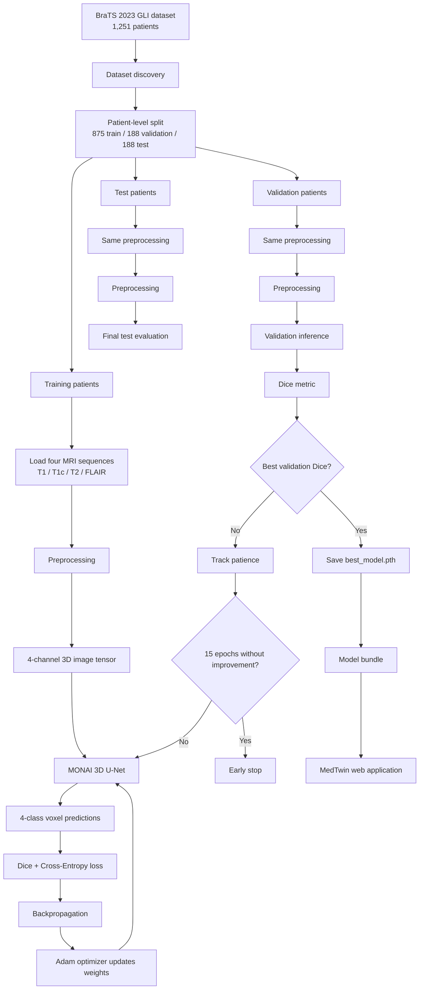

# MedTwin-AI Training Architecture

This document describes how the brain-tumor segmentation model is trained and how the
trained model is later used by the application.

> The model is a research and decision-support prototype. Its predictions must be
> reviewed by a qualified clinician.

## 1. End-to-end architecture



## 2. Dataset and labels

The training pipeline uses the BraTS 2023 Adult Glioma dataset. Each complete patient
case contains:

| Input or target | Meaning |
|---|---|
| T1 | Native T1-weighted MRI |
| T1c | Contrast-enhanced T1 MRI |
| T2 | T2-weighted MRI |
| FLAIR | T2-FLAIR MRI |
| Segmentation mask | Expert voxel-level tumor labels |

The segmentation mask is the **target**, not an input. The model receives only the four
MRI sequences and learns to reproduce the expert mask.

The split is performed at patient level using seed `42`:

| Split | Patients | Purpose |
|---|---:|---|
| Training | 875 | Update model weights |
| Validation | 188 | Select the best checkpoint and monitor overfitting |
| Test | 188 | Final unbiased evaluation |

Keeping a patient's scans in only one split prevents data leakage.

## 3. Preprocessing pipeline

Each MRI sequence and its corresponding mask pass through the following spatial
preparation:

```text
Load NIfTI files
    ↓
Ensure channel-first layout
    ↓
Convert orientation to RAS
    ↓
Resample to 1 mm × 1 mm × 1 mm
    ↓
Normalize MRI intensities using non-zero voxels
    ↓
Concatenate T1, T1c, T2 and FLAIR
    ↓
Crop to the foreground brain region
    ↓
Pad dimensions to a multiple of 8
    ↓
Send image and target to the network
```

Images use bilinear interpolation during resampling. Labels use nearest-neighbor
interpolation so label IDs remain discrete and are not blended.

The resulting tensors have this general structure:

```text
Image:  (batch, 4, X, Y, Z)
Target: (batch, 1, X, Y, Z)
```

## 4. Neural network architecture

The segmentation network is a MONAI 3D U-Net implemented with PyTorch.

```text
Input volume
  4 channels: T1, T1c, T2, FLAIR
        │
        ▼
Encoder: 3D convolutions and downsampling
  channels: 16 → 32 → 64 → 128
  strides:  2  → 2  → 2
  residual units: 2 per level
  normalization: batch normalization
        │
        ▼
Bottleneck
        │
        ▼
Decoder: upsampling with U-Net skip connections
        │
        ▼
Output volume
  4 channels: background, necrotic core, edema, enhancing tumor
```

The network produces four raw output channels for every voxel. A softmax converts
these outputs into class probabilities. The class with the highest probability becomes
the predicted label.

## 5. Loss and optimization

The training loss is:

```text
Total loss = Dice loss + Cross-Entropy loss
```

- Dice loss encourages overlap between the predicted tumor regions and expert regions.
- Cross-entropy penalizes incorrect class predictions for individual voxels.

Training configuration:

| Setting | Value |
|---|---|
| Optimizer | Adam |
| Learning rate | `1e-4` |
| Weight decay | `1e-5` |
| Learning-rate schedule | Cosine annealing |
| Batch size | 1 |
| Maximum epochs | 50 |
| Early-stopping patience | 15 epochs |

## 6. Training loop

For each epoch, the pipeline performs these steps:

1. Put the network into training mode.
2. Load one preprocessed patient batch.
3. Run a forward pass through the 3D U-Net.
4. Calculate Dice plus cross-entropy loss.
5. Clear previous gradients.
6. Backpropagate the loss.
7. Update network weights with Adam.
8. Run validation without gradient updates.
9. Convert predictions and labels to one-hot class maps.
10. Calculate the mean Dice score excluding background.
11. Save the network if validation Dice improves.
12. Stop early after 15 consecutive epochs without improvement.

The training code is in
[`02_Glioma_Segmentation_Training_Pipeline.ipynb`](notebook/02_Glioma_Segmentation_Training_Pipeline.ipynb).

## 7. Validation and checkpointing

The test set is not used during training or checkpoint selection. Validation Dice is
used to select the best model. The saved checkpoint contains the best network weights:

```text
outputs/checkpoints/best_model.pth
```

The model configuration, label mapping, modality order, and preprocessing settings are
stored in:

```text
outputs/model_bundle/model_bundle.json
```

## 8. Application inference

The web application reconstructs the same network from the model bundle and loads the
saved checkpoint. It then:

1. Applies the same preprocessing.
2. Divides the prepared volume into overlapping `96 × 96 × 96` windows.
3. Runs the 3D U-Net on each window.
4. Combines the window predictions using Gaussian blending.
5. Selects the winning class for each voxel.
6. Calculates confidence, tumor location, volume, and 3D meshes.

The application does **not** retrain the model during normal use. This loading and
inference logic is implemented in
[`medtwin/model.py`](medtwin_app/medtwin/model.py).

## 9. Important distinction

```text
Training:
MRI + expert mask → calculate error → update weights

Inference:
MRI only → load fixed weights → predict mask
```

The expert mask is available during training and evaluation, but it is not required
when analyzing a new patient.
